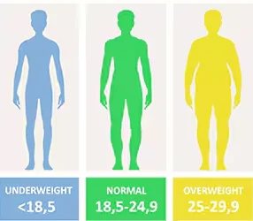

# Day 3 - Beginner - Control Flow and Logical Operators

## Content

### Condition check

Learn to use **conditionals** in Python to check a condition and tell the computer what to do in each case.

```python
if <this condition is true>:
    <then execute this line of code>
```

Example:

```python
print("Welcome to the rollercoaster!")
height = int(input("What is your height in cm? "))

if height >= 120:
    print("You can ride the rollercoaster.")
```

- `if` starts the check.
- After `if` comes a condition that is either `True` or `False`.
- A colon `:` ends the condition line.
- The indented line(s) run **only** when the condition is true.

### What if the condition is false?

The `else` keyword defines a block of code that runs if the condition in the `if` statement is **false**.

```python
if pigs can fly:
    <Some code that will never execute>
else:
    print("This is real life")
```

A valid version of the same idea:

```python
if height >= 120:
    print("You can ride the rollercoaster.")
else:
    print("Sorry, you have to grow taller before you can ride.")
```

- The computer always chooses **one** path: either the `if` block or the `else` block, never both.
- `else` does not take a condition. It means “in every other case”.

### Python indentation

Indentation is how Python shows that some lines **belong to** other lines. Indented lines are children of the parent line above them.

```python
if 5 > 2:          # This is a parent line of code
    print("yes")   # this is a child line of code
```

- Use **4 spaces** (PyCharm does this when you press Tab).
- Everything at the same indent level is in the same block.
- If you forget the indent after `if` or `else`, Python raises an **IndentationError**.
- Mixing tabs and spaces can also break the program.

### Comparator operators

These operators compare two values and give a boolean: `True` or `False`. They are what you put in the `if` condition.

| Operator | Meaning |
| --- | --- |
| `>` | Greater than |
| `<` | Less than |
| `>=` | Greater than or equal to |
| `<=` | Less than or equal to |
| `==` | Equal to |
| `!=` | Not equal to |

```python
print(5 > 2)     # True
print(5 < 2)     # False
print(5 >= 5)    # True
print(5 <= 4)    # False
print(5 == 5)    # True
print(5 != 2)    # True
```

- `==` checks equality. A single `=` is **assignment** (store a value in a variable).
- `!=` means “not equal to”.
- You can compare numbers (`height >= 120`) and also strings (`name == "Angela"`).

### Modulo

The **modulo** operator is `%`. It does **not** answer “how many times does this fit?”. It answers: **what is left over** after you divide.

Think of sharing 6 cookies into groups of 2: you get 3 full groups and **0 leftover**. Sharing 6 into groups of 5: one group of 5, and **1 leftover**.

```python
print(6 % 2)  # 0  — 6 = 2 + 2 + 2, nothing left
print(6 % 5)  # 1  — 6 = 5 + 1
print(6 % 4)  # 2  — 6 = 4 + 2
```

- Left number: what you are dividing.
- Right number: the group size.
- Result: the remainder (always smaller than the right number).

**What is `10 % 3`?**

```python
print(10 % 3)
```

`3` fits into `10` three times (`3 × 3 = 9`), and **1** is left. So the output is `1`.

A very common use is checking **even or odd**. Even numbers divide by `2` with remainder `0`. Odd numbers leave remainder `1`.

```python
number = int(input("Type a number: "))

if number % 2 == 0:
    print("Even")
else:
    print("Odd")
```

### Nesting

**Nesting** means putting an `if` **inside** another `if`. You ask a second question only after the first one is already true.

The rollercoaster example: first check height. Only if the person can ride, then check age to pick a ticket price.

```python
height = int(input("What is your height in cm? "))

if height >= 120:
    print("You can ride the rollercoaster.")
    age = int(input("What is your age? "))
    if age < 12:
        print("Please pay $5.")
    else:
        print("Please pay $7.")
else:
    print("Sorry, you have to grow taller before you can ride.")
```

- The inner `if`/`else` is indented **one extra level**. It belongs to the outer `if`.
- If `height < 120`, Python never asks for age. The nested block is skipped.
- Nesting is for questions that depend on a previous yes: “Can they ride? **If yes**, how much do they pay?”

### `elif`

`else` only covers “everything else”. When you have **more than two** options, use `elif` (“else if”). It adds another condition in the same chain.

```python
if age < 12:
    print("Please pay $5.")
elif age <= 18:
    print("Please pay $7.")
else:
    print("Please pay $12.")
```

- Python checks from top to bottom and runs **only the first** block whose condition is true.
- After one block runs, the rest of the chain is skipped.
- You can stack several `elif` lines. `else` at the end is the fallback (optional, but useful).
- `elif` must sit between `if` and `else`, at the **same indent** as `if`.

Together with nesting:

```python
if height >= 120:
    print("You can ride the rollercoaster.")
    age = int(input("What is your age? "))
    if age < 12:
        print("Please pay $5.")
    elif age <= 18:
        print("Please pay $7.")
    else:
        print("Please pay $12.")
else:
    print("Sorry, you have to grow taller before you can ride.")
```

## Check Odd or Even

### Exercise

Write some code using what you have learnt about the modulo operator and conditional checks in Python to check if the number in the input area is odd or even. If it's odd print out the word `"Odd"` otherwise print out `"Even"`.

### Solution

```python
number = int(input())

if number % 2 == 0:
    print("Even")
else:
    print("Odd")
```

## BMI Calculator with Interpretations

### Exercise

Add some `if`/`elif`/`else` statements to the BMI calculator so that it interprets the BMI values calculated.

- If the bmi is under 18.5 (not including), print out `"underweight"`
- If the bmi is between 18.5 (including) and 25 (not including), print out `"normal weight"`
- If the bmi is 25 (including) or over, print out `"overweight"`

Refer to this graphic for help:



### Solution

Tested and run successfully in PyCharm.

```python
weight = 85
height = 1.85

bmi = weight / (height ** 2)

# 🚨 Do not modify the values above
# Write your code below 👇
if bmi < 18.5:
    print("underweight")
elif bmi < 25:
    print("normal weight")
else:
    print("overweight")
```
